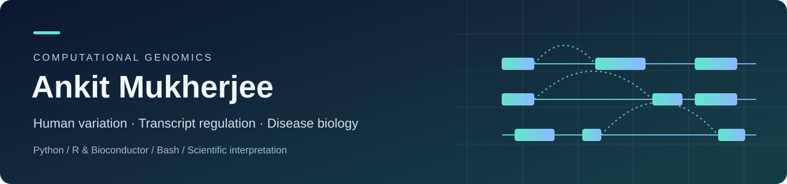

  <a href="https://github.com/AnkitMukherji/CV"><b>Research CV</b></a> &nbsp; · &nbsp;
  <a href="https://scholar.google.com/citations?user=2D5kUnQAAAAJ">Google Scholar</a> &nbsp; · &nbsp;
  <a href="https://orcid.org/0009-0005-5847-5986">ORCID</a> &nbsp; · &nbsp;
  <a href="https://www.linkedin.com/in/ankit-mukherjee-647ab81ba/">LinkedIn</a> &nbsp; · &nbsp;
  <a href="mailto:ankit0204.am@gmail.com">Email</a>

I am a **Project Research Scientist I at CSIR–Institute of Genomics and Integrative Biology (CSIR-IGIB)**. I study how human genetic variation and transcript regulation relate to health and disease, combining computational analysis with statistical reasoning and biological interpretation.

My research spans **GenomeIndia population pharmacogenomics**, **Friedreich ataxia transcriptomics**, and **PPP2R2B transcript regulation in SCA12**.

## Publication highlight

> ### GI-DB · Nucleic Acids Research
> **Joint first author** · Published online **19 November 2026**
>
> **GI-DB: a comprehensive variant database for exploring the extensive genetic diversity of the Indian population.** Uppili B, Mukherjee A, et al. *Nucleic Acids Research*, gkag1179 (2026).
>
> A public resource for genetic variation across **9,768 whole genomes and 83 Indian populations**. My contributions included data curation, formal analysis, methodology, visualization and writing the original draft.
>
> [Read the paper](https://doi.org/10.1093/nar/gkag1179) &nbsp; · &nbsp; [Explore GI-DB](https://ibdc.dbt.gov.in/gidb/)

## Research projects

| Population variation & drug response | Transcript regulation & disease |
| --- | --- |
| **GenomeIndia pharmacogenomics** Variant annotation, population allele frequencies, pharmacogene haplotypes and predicted metabolizer phenotypes.  [Analysis code](https://github.com/AnkitMukherji/Medical_Relevance_GI) · [Phasing & imputation](https://github.com/AnkitMukherji/Phasing_Imputation) | **SCA12 and PPP2R2B** Clinical phenotypes, short- and long-read transcript reconstruction, reference comparisons and exploratory organoid single-cell analysis.  [Project overview](https://github.com/AnkitMukherji/SCA12_Analysis) · [Transcript workflow guides](https://github.com/AnkitMukherji/SCA12_Analysis/tree/main/scripts/isoform_analysis) |
| **Statistical genetics** Bayesian colocalisation, allele and LD alignment, prior sensitivity and multiple-signal analyses.  [Worked analyses](https://github.com/AnkitMukherji/statistical_genetics/tree/main/coloc) | **Friedreich ataxia** Blood expression, pathway activity and co-expression networks, alongside iPSC-derived cardiomyocyte maturation and cardiac-phenotype contrasts.  [Blood transcriptomics](https://github.com/AnkitMukherji/FRDA_Analysis) · [Cardiomyocyte RNA-seq](https://github.com/AnkitMukherji/FRDA_Cardiomyopathy_Analysis) |

### Single-cell methods and scientific replication

I compare marker-based annotation, classifiers and reference mapping across Python/scverse and R/Bioconductor workflows. My pancreas paper-replication project revisits published methods, compares a modern analysis route, and explores follow-up questions.

[Single-cell workflows](https://github.com/AnkitMukherji/single_cell_analysis) · [Pancreas paper replication](https://github.com/AnkitMukherji/Paper_Replication)

## Technical practice

| Computation | Analysis & interpretation |
| --- | --- |
| **Python · R/Bioconductor · Bash · Perl** Scientific computing, biological file processing and visualization | **Population and medical genomics** Variant harmonization, functional annotation, pharmacogenomic evidence and haplotype methods |
| **HPC · SLURM · Git · Conda · renv** Research computing, version control and environment management | **Bulk and single-cell transcriptomics** Differential expression, pathway enrichment, WGCNA and clinical associations |
| **Docker · Singularity** Container-based research environments | **Statistical reasoning** Study design, confounding, effect sizes, uncertainty and model assumptions |

I start with the biological question and study design, inspect data quality and technical structure, and connect effect sizes and uncertainty to the phenotype. My project READMEs explain the scientific scope and reproduction requirements. Folder guides document individual scripts, inputs, outputs and workflow order.

## Computational foundations

| Collection | What it explores |
| --- | --- |
| [Bioinformatics algorithms](https://github.com/AnkitMukherji/Bioinformatics-Algorithms) | Replication-origin patterns, motif discovery and assembly graphs |
| [DNA sequencing algorithms](https://github.com/AnkitMukherji/Algorithms-for-DNA-Sequencing) | Read matching, dynamic-programming alignment, overlaps and assembly |
| [Python for genomics](https://github.com/AnkitMukherji/Python-for-Genomics) · [Perl structural bioinformatics](https://github.com/AnkitMukherji/Perl-Codes) | Sequence handling, file parsing and molecular geometry |
| [Viral protein evolution](https://github.com/AnkitMukherji/mutations_virus) | MSc dissertation work on sequence-derived substitution matrices |
| [Life-science statistics](https://github.com/AnkitMukherji/Data_Analysis_for_Life_Sciences) · [Mathematics for machine learning](https://github.com/AnkitMukherji/Machine_Learning) | Statistical inference, linear algebra and optimization |

<b>Consortium code, reference collections and research communication</b>

- [GenomeIndia consortium code fork](https://github.com/AnkitMukherji/Flagship-Paper-Codes) preserves the upstream contributors' authorship and analysis context.
- [Spatial transcriptomics resources](https://github.com/AnkitMukherji/awesome-spatial-transcriptomics), [bioinformatics curriculum](https://github.com/AnkitMukherji/bioinformatics_courses) and [learning resources](https://github.com/AnkitMukherji/learning-bioinformatics-at-home) are attributed upstream forks.
- [Conference poster and contact card](https://github.com/AnkitMukherji/ankit-research-contact-card) connects the research presentation with downloadable material and academic profiles.

---

**MSc Bioinformatics**, Savitribai Phule Pune University · **BSc Microbiology**, University of Calcutta

Research mentorship, conference presentations, publications and professional experience are documented in my [CV](https://github.com/AnkitMukherji/CV).
